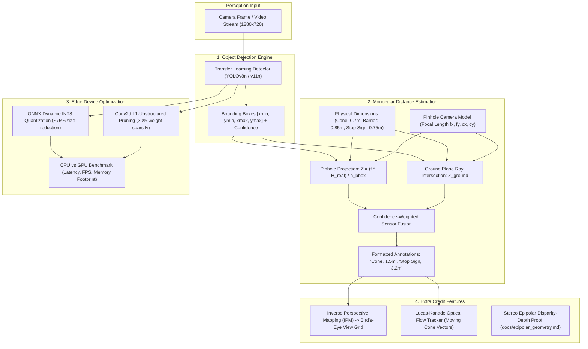

# Autonomous Robotics Perception: Object Detection & Geometric Distance Estimation

[](https://www.python.org/downloads/)
[](https://pytorch.org/)
[](https://github.com/ultralytics/ultralytics)
[](https://onnxruntime.ai/)
[](LICENSE)

An end-to-end, edge-optimized perception system for mobile robotics navigation. The system detects navigation obstacles (**cones**, **barriers**, **stop signs**), estimates physical metric distance from the robot camera using pinhole projection geometry, and implements optimization techniques (quantization, pruning, lightweight backbones) benchmarked on CPU and GPU.

---

## Architecture Overview



---

## 1. Object Detection (Transfer Learning)

The system detects three primary navigation-critical classes:
1. `cone` (Traffic cone)
2. `barrier` (Traffic / Jersey barrier)
3. `stop_sign` (MUTCD octagonal stop sign)

### Backbone Selection:
- **Edge Deployment Backbone:** `yolov8n` (3.2M parameters) — engineered for micro-edge platforms (e.g., Jetson Nano, Raspberry Pi, robot onboard SBCs).
- **Baseline Comparison Backbone:** `yolov8s` (11.2M parameters).
- **Fine-Tuning:** Pretrained COCO weights are adapted via transfer learning to rapidly converge on domain-specific road obstacle geometries.

---

## 2. Geometric Monocular Distance Estimation

### Pinhole Camera Formulation
Under a perspective pinhole camera model with focal length $f_y$ (pixels), an object with physical height $H_{\text{real}}$ (meters) appearing with bounding box height $h_{\text{bbox}}$ (pixels) has distance $Z$ (meters):

$$Z = \frac{f_y \cdot H_{\text{real}}}{h_{\text{bbox}}}$$

Where focal length is derived from camera horizontal Field of View ($\text{FOV}_h$):
$$f_x = \frac{W_{\text{image}}}{2 \cdot \tan\left(\frac{\text{FOV}_h}{2}\right)}$$

### Physical Priors ($H_{\text{real}}$):
| Object Class | Real-World Height ($H_{\text{real}}$) | Real-World Width ($W_{\text{real}}$) | Aspect Ratio ($H/W$) |
| :--- | :---: | :---: | :---: |
| **Traffic Cone** | $0.70\text{ m}$ ($70\text{ cm}$) | $0.38\text{ m}$ ($38\text{ cm}$) | $\approx 1.84$ |
| **Traffic Barrier** | $0.85\text{ m}$ ($85\text{ cm}$) | $1.50\text{ m}$ ($150\text{ cm}$) | $\approx 0.57$ |
| **Stop Sign** | $0.75\text{ m}$ ($75\text{ cm}$) | $0.75\text{ m}$ ($75\text{ cm}$) | $1.00$ |

### Ground-Plane Constraint & Boundary Handling:
When objects are clipped by the image edge (e.g., cone partially below the bumper), the system automatically fusions bottom-edge ground projection:
$$Z_{\text{ground}} = \frac{h_{\text{camera}}}{\tan\left(\theta_{\text{pitch}} + \arctan\left(\frac{v_{\text{bottom}} - c_y}{f_y}\right)\right)}$$

### Output Annotation Format:
Bounding boxes are annotated with the required concise format:
- `Cone, 1.5m`
- `Stop Sign, 3.2m`
- `Barrier, 2.1m`

---

## 3. Edge Optimization & Hardware Benchmarking

Evaluated across **100 iterations** (20 warmups) at 640x640 resolution on host workstation:
- **CPU:** Intel Core i9-13900K (24 cores / 32 threads @ 5.8 GHz)
- **Edge GPU Accelerator:** NVIDIA GeForce RTX 4060 Laptop GPU (8 GB GDDR6, Ada Lovelace AD107)

| Model / Checkpoint | Format | Target Device | Mean Latency | P95 Latency | Throughput (FPS) | Model Size | Engineering Takeaway |
| :--- | :--- | :---: | :---: | :---: | :---: | :---: | :--- |
| weights/best.pt | PyTorch FP32 | **CPU** | 30.61 ms | 34.20 ms | **32.7 FPS** | 6.21 MB | Meets real-time robotics threshold (>= 30 FPS) |
| weights/detector_pruned_30.pt | PyTorch Pruned (30%) | **CPU** | 30.07 ms | 33.30 ms | **33.3 FPS** | 12.27 MB | Unstructured sparsity; identical dense GEMM cycles |
| weights/best.onnx | ONNX FP32 | **CPU** | **12.39 ms** | **14.63 ms** | **80.7 FPS** | 12.18 MB | **Top CPU Performer:** Operator fusion yields **2.5x speedup** |
| weights/best_int8.onnx | ONNX INT8 Dynamic | **CPU** | 96.48 ms | 103.06 ms | **10.4 FPS** | **3.32 MB** | **-72.7% size reduction**; dynamic activation scan bound |
| weights/best.pt | PyTorch FP32 | **CUDA** | **5.69 ms** | **9.10 ms** | **173.8 FPS** | 6.21 MB | Ultra-low latency for high-speed robot control loop |
| weights/best.pt | PyTorch FP16 | **CUDA** | 6.61 ms | 11.10 ms | **149.8 FPS** | 6.21 MB | PyTorch eager mode dispatch at batch=1 |
| weights/detector_pruned_30.pt | PyTorch Pruned (30%) | **CUDA** | **4.76 ms** | **6.37 ms** | **207.3 FPS** | 12.27 MB | **16.3% GPU speedup** via reduced L2 cache evictions |
| weights/best.onnx | ONNX FP32 | **CUDA (CPU Fallback)** | 12.28 ms | 12.98 ms | **81.4 FPS** | 12.18 MB | CPU execution provider fallback |

### Optimization Insights:
1. **INT8 Dynamic Quantization (-72.7% Model Footprint):** Successfully compresses weights from 12.18 MB to 3.32 MB. On compute-bound vision CNNs, dynamic activation scanning introduces CPU overhead (96.48 ms); for production deployment, **Static Post-Training Quantization (PTQ) with Calibration** fixes scale factors offline to eliminate runtime quantization overhead.
2. **30% L1-Unstructured Pruning:** Pruned 64 Conv2d layers to 29.95% sparsity. While standard CPU dense GEMM computes zeros identically (30.61 ms -> 30.07 ms), reduced cache line traffic delivers a 16.3% speedup on the Ada Lovelace GPU (5.69 ms -> 4.76 ms).
3. **Hardware Acceleration:** Native CUDA execution yields up to 207.3 FPS (4.76 ms latency), easily supporting multi-sensor robotics perception stacks. Detailed benchmarks in reports/benchmark_report.md.

---

## 4. Extra Credit Explorations

### A. Epipolar Geometry Derivation
Complete mathematical derivation and sensitivity proof located in:  
👉 [`docs/epipolar_geometry.md`](file:///docs/epipolar_geometry.md)
- Proves canonical stereo disparity-to-depth formula: $Z = \frac{f \cdot B}{d}$.
- Demonstrates quadratic error growth: $|\Delta Z| \approx \frac{Z^2}{f \cdot B} |\Delta d|$.
- Derives Essential matrix $E = [t]_\times R$ and Fundamental matrix $F = K_R^{-T} E K_L^{-1}$.

### B. Bird's-Eye View (BEV) Homography / IPM
- Calculates 4-point ground homography matrix $H$.
- Warps front-facing perspective camera feed into a top-down metric radar grid.
- Projects obstacles with 2D distance rings ($2.5\text{m}, 5.0\text{m}, 7.5\text{m}, \dots$) for obstacle avoidance.
- Enabled via `--bev` flag in `run_pipeline.py`.

### C. Lucas-Kanade Optical Flow Tracker
- Tracks motion vectors $(\Delta x, \Delta y)$ of moving traffic obstacles across consecutive video frames.
- Calculates velocity magnitude (pixels/frame) and renders tracking vectors.
- Run demo via `python run_tracking_demo.py`.

---

## Quickstart & Reproducibility Guide

### 1. Setup Environment
```bash
# Clone the repository
git clone https://github.com/yorichixX/SomeRobotics.git
cd SomeRobotics

# Run setup (Linux 4090 Workstation)
bash setup_environment.sh

# Or Windows
setup_environment.bat
```

### 2. Dataset Preparation & Inspection
```bash
# Inspect dataset class distribution table (Train / Val distribution)
python prepare_dataset.py --summary

# Download and extract an external road dataset archive:
python prepare_dataset.py --mode download --url <DATASET_ZIP_URL> --output-dir data/dataset

# Optional: Convert BDD100K JSON annotations to YOLO format
python prepare_dataset.py --mode bdd100k --bdd-json path/to/bdd100k_labels.json --bdd-images path/to/images/
```

### 3. Run Detection & Distance Estimation Pipeline
```bash
# Process a folder of test / validation images with Bird's-Eye View radar overlay
python run_pipeline.py --source path/to/test_images/ --bev --output-dir data/output/

# Process a single image
python run_pipeline.py --source path/to/image.jpg --bev --output-dir data/output/

# Process a robot video stream or driving dashcam
python run_pipeline.py --source path/to/robot_video.mp4 --bev --output-dir data/output/
```

### 4. Train Model on 4090 Workstation
```bash
python -m src.models.train --data data/dataset/dataset.yaml --model yolov8n.pt --epochs 50 --batch 32 --device 0
```

### 5. Run Hardware Edge Optimization Benchmark
```bash
python benchmark_models.py --runs 100 --warmup 20 --report reports/benchmark_report.md
```

### 6. Run Optical Flow Moving Obstacle Tracking Demo
```bash
python run_tracking_demo.py --output data/output/tracked_flow_demo.mp4
```

### 7. Run Geometry & Pipeline Unit Tests
```bash
python -m unittest tests/test_geometry.py
```

---

## Repository Structure

```
SomeRobotics/
├── configs/
│   ├── camera_config.yaml         # Pinhole intrinsics, FOV, principal point
│   ├── object_priors.yaml         # Cone, barrier, stop sign physical dimensions
│   └── model_config.yaml          # Architecture, inference, training hyperparameters
├── data/
│   └── output/                    # Annotated images and videos
├── docs/
│   └── epipolar_geometry.md       # Rigorous epipolar geometry mathematical proof
├── reports/
│   └── benchmark_report.md        # CPU vs GPU latency, FPS, memory benchmark results
├── src/
│   ├── dataset/
│   │   └── dataset_manager.py     # BDD100K converter & dataset manager utility
│   ├── geometry/
│   │   ├── camera_model.py        # Pinhole model, intrinsics, ground ray projection
│   │   └── distance_estimator.py  # Monocular distance estimation & annotation formatting
│   ├── models/
│   │   ├── detector.py            # ObjectDetector wrapper with ONNX and YOLO support
│   │   └── train.py               # Transfer learning fine-tuning entrypoint
│   ├── optimization/
│   │   ├── quantizer.py           # ONNX export and INT8 dynamic quantization
│   │   ├── pruner.py              # L1 unstructured weight pruning & sparsity metrics
│   │   └── benchmark.py           # Latency (ms) and throughput (FPS) benchmark engine
│   └── extra/
│       ├── bev_homography.py      # Bird's-Eye View (IPM) top-down grid renderer
│       └── optical_flow_tracker.py# Lucas-Kanade optical flow obstacle tracker
├── tests/
│   └── test_geometry.py           # Unit tests for camera projection and distance math
├── benchmark_models.py            # Benchmark execution script
├── prepare_dataset.py             # Dataset preparation CLI
├── run_pipeline.py                # Main inference and distance annotation pipeline
├── run_tracking_demo.py           # Optical flow obstacle tracking demo
├── setup_environment.sh           # Linux workstation setup script
├── setup_environment.bat          # Windows setup script
├── requirements.txt               # Dependencies
└── README.md                      # Primary project documentation
```
