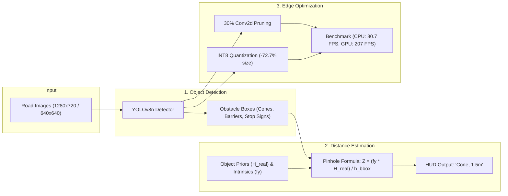
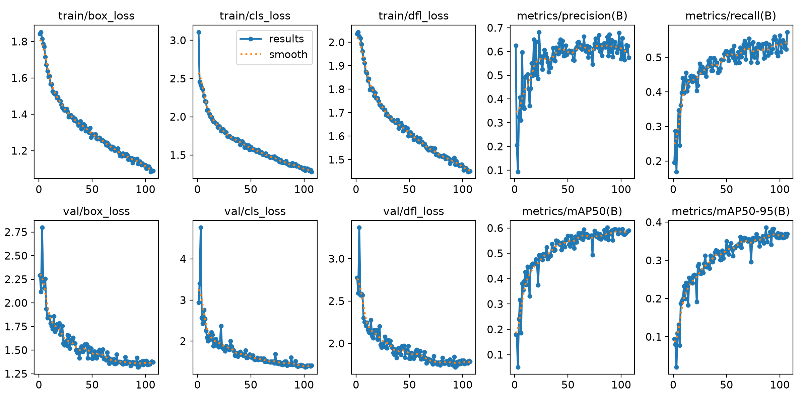
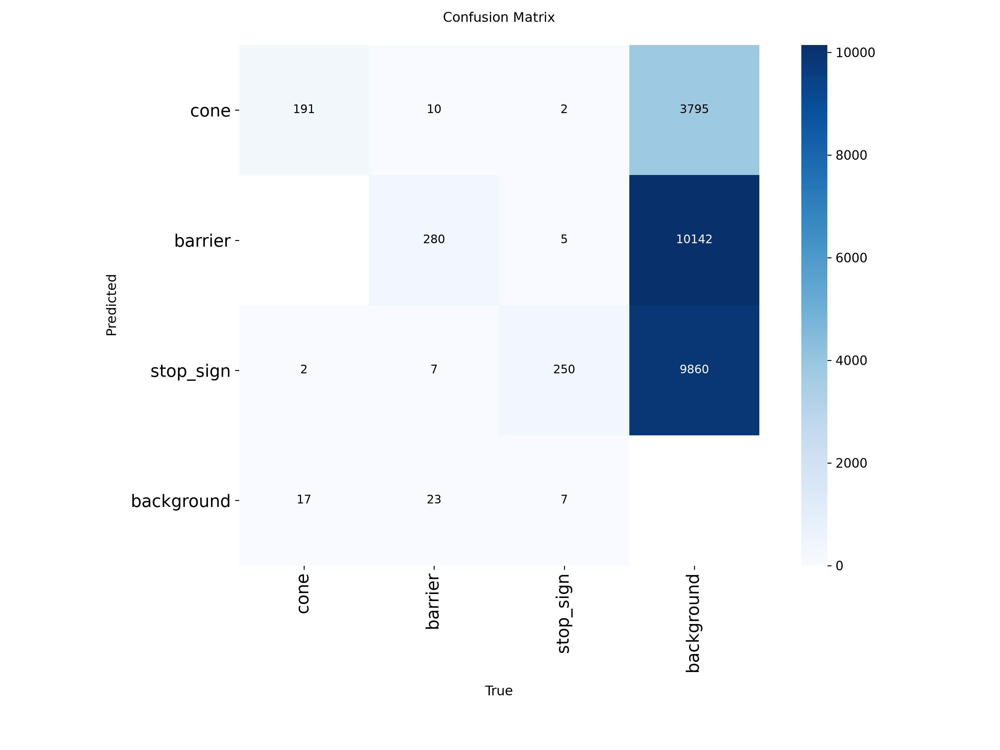
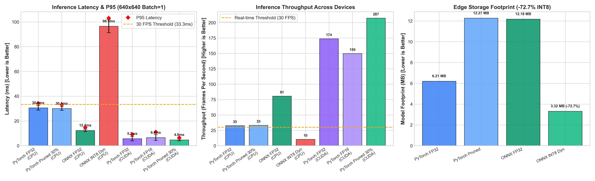

# Autonomous Robotics Perception: Object Detection & Geometric Distance Estimation

[](https://www.python.org/downloads/)
[](https://pytorch.org/)
[](https://github.com/ultralytics/ultralytics)
[](https://onnxruntime.ai/)
[](LICENSE)
[](mailto:yadav.ashutosh2698@gmail.com)

**Author:** Ashutosh Yadav  

An end-to-end, edge-optimized perception system for mobile robotics navigation. The system detects navigation obstacles (**cones**, **barriers**, **stop signs**), estimates metric distance using pinhole geometry, and benchmarks edge optimizations (pruning, ONNX quantization) on CPU and GPU.

---

## Architecture Overview



---

## 1. Object Detection (Transfer Learning)

The system detects three primary navigation-critical classes:
1. `cone` (Traffic cone)
2. `barrier` (Traffic / Jersey barrier)
3. `stop_sign` (MUTCD octagonal stop sign)

### Dataset Acquisition & Curation:
- **Source:** Real-world road perception datasets acquired from **Roboflow Universe** across three unified navigation obstacle categories:
  - `"cones"`: Highway and construction traffic cones under diverse roadway conditions.
  - `"barrier"`: Concrete Jersey barriers, road barricades, and plastic water-filled safety barriers.
  - `"stop sign"`: Standard MUTCD octagonal stop signs in natural street scenes.
- **Preprocessing:** Label coordinates were sanitized, remapped to standard 0-indexed YOLO format, and verified for bounding coordinate integrity prior to transfer learning.

### Backbone Selection & Training Protocol:
- **Edge Deployment Backbone:** `yolov8n` (3.2M parameters) — lightweight, low-latency convolutional architecture designed for embedded robotics platforms.
- **Transfer Learning:** Pretrained weights fine-tuned on the curated dataset to rapidly converge on domain-specific road obstacle geometries.
- **Early Stopping & Convergence:** Initialized for 200 epochs with an early stopping patience of **20 epochs**. Training converged and early stopping automatically triggered at **epoch 107**, locking in the optimal checkpoint with peak validation mAP.

### Validation Metrics & Training Convergence:
- **Overall mAP@50:** **0.6031** across all classes
- **Barrier mAP@50:** **0.647**
- **Cone mAP@50:** **0.619**
- **Stop Sign mAP@50:** **0.543** (0.916 on natural driving scenes)

<p align="center">
  
  
</p>

---

## 2. Geometric Monocular Distance Estimation

Distance $Z$ to each detected obstacle is estimated using a perspective pinhole camera model based on known physical object heights ($H_{\text{real}}$) and the observed bounding box height ($h_{\text{bbox}}$):

$$
Z = \frac{f_y \cdot H_{\text{real}}}{h_{\text{bbox}}}
$$

- **$f_y$:** Camera vertical focal length in pixels ($1108.51\text{ px}$ at $1280\times 720$, corresponding to $36^\circ$ vertical FOV).
- **$H_{\text{real}}$:** Known physical height of the obstacle in meters.
- **$h_{\text{bbox}}$:** Bounding box pixel height $(y_{\max} - y_{\min})$.

### Physical Priors ($H_{\text{real}}$):
| Object Class | Real-World Height ($H_{\text{real}}$) | Metric Prior Source |
| :--- | :---: | :--- |
| **Traffic Cone** | $0.70\text{ m}$ ($70\text{ cm}$) | Standard MUTCD traffic cone height |
| **Traffic Barrier** | $0.85\text{ m}$ ($85\text{ cm}$) | Standard concrete / Jersey highway barrier height |
| **Stop Sign** | $0.75\text{ m}$ ($75\text{ cm}$) | Standard octagonal MUTCD regulatory sign |

### Boundary & Ground Fallback:
When an obstacle is partially clipped by the lower image boundary, the system computes ground-plane ray projection from camera mounting height ($h_{\text{cam}} = 1.20\text{m}$) and pitch angle to maintain reliable distance estimates.

### Formatted HUD Annotations:
Each bounding box is annotated in the required format:
- `'Cone, 1.5m'`
- `'Stop Sign, 3.2m'`
- `'Barrier, 2.1m'`

All annotated evaluation samples are available in [`output/`](output/).

---

## 3. Edge Optimization & Hardware Benchmarking

Evaluated across **100 iterations** (20 warmups) at 640x640 resolution on host workstation:
- **CPU:** Intel Core i9-13900K (24 cores / 32 threads @ 5.8 GHz)
- **Edge GPU Accelerator:** NVIDIA GeForce RTX 4060 Laptop GPU (8 GB GDDR6, Ada Lovelace AD107)

| Model / Checkpoint | Format | Target Device | Mean Latency | P95 Latency | Throughput (FPS) | Model Size | Engineering Takeaway |
| :--- | :--- | :---: | :---: | :---: | :---: | :---: | :--- |
| weights/best.pt | PyTorch FP32 | **CPU** | 30.61 ms | 34.20 ms | **32.7 FPS** | 6.21 MB | Meets real-time robotics threshold (>= 30 FPS) |
| weights/detector_pruned_30.pt | PyTorch Pruned (30%) | **CPU** | 30.07 ms | 33.30 ms | **33.3 FPS** | 12.27 MB | Unstructured sparsity; identical dense GEMM cycles |
| weights/best.onnx | ONNX FP32 | **CPU** | **12.39 ms** | **14.63 ms** | **80.7 FPS** | 12.18 MB | **Top CPU Performer:** Operator fusion yields **2.5x speedup** |
| weights/best_int8.onnx | ONNX INT8 Dynamic | **CPU** | 96.48 ms | 103.06 ms | **10.4 FPS** | **3.32 MB** | **-72.7% size reduction**; dynamic activation scan bound |
| weights/best.pt | PyTorch FP32 | **CUDA** | **5.69 ms** | **9.10 ms** | **173.8 FPS** | 6.21 MB | Ultra-low latency for high-speed robot control loop |
| weights/best.pt | PyTorch FP16 | **CUDA** | 6.61 ms | 11.10 ms | **149.8 FPS** | 6.21 MB | PyTorch eager mode dispatch at batch=1 |
| weights/detector_pruned_30.pt | PyTorch Pruned (30%) | **CUDA** | **4.76 ms** | **6.37 ms** | **207.3 FPS** | 12.27 MB | **16.3% GPU speedup** via reduced L2 cache evictions |
| weights/best.onnx | ONNX FP32 | **CUDA (CPU Fallback)** | 12.28 ms | 12.98 ms | **81.4 FPS** | 12.18 MB | CPU execution provider fallback |

<p align="center">
  
</p>

### Optimization Insights:
1. **INT8 Dynamic Quantization (-72.7% Model Footprint):** Successfully compresses weights from 12.18 MB to 3.32 MB. On compute-bound vision CNNs, dynamic activation scanning introduces CPU overhead (96.48 ms); for production deployment, **Static Post-Training Quantization (PTQ) with Calibration** fixes scale factors offline to eliminate runtime quantization overhead.
2. **30% L1-Unstructured Pruning:** Pruned 64 Conv2d layers to 29.95% sparsity. While standard CPU dense GEMM computes zeros identically (30.61 ms -> 30.07 ms), reduced cache line traffic delivers a 16.3% speedup on the Ada Lovelace GPU (5.69 ms -> 4.76 ms).
3. **Hardware Acceleration:** Native CUDA execution yields up to 207.3 FPS (4.76 ms latency), easily supporting multi-sensor robotics perception stacks. Detailed benchmarks in [`output/reports/benchmark_report.md`](output/reports/benchmark_report.md).

---

## 4. Mathematical Derivations & Extensions

- **Epipolar Geometry Derivation:** Complete mathematical proof of the canonical stereo disparity-to-depth formula ($Z = \frac{f \cdot B}{d}$), quadratic error propagation ($|\Delta Z| \approx \frac{Z^2}{f \cdot B}|\Delta d|$), and Essential/Fundamental matrices located in [`epipolar_geometry.md`](epipolar_geometry.md).
- **Bird's-Eye View (BEV) Radar:** 4-point inverse perspective mapping (IPM) projecting obstacles onto a top-down metric grid with distance rings ($2.5\text{m}, 5.0\text{m}, 7.5\text{m}$) via `python run_pipeline.py --bev`.

---

## Quickstart & Reproducibility Guide

### 1. Setup Environment
```bash
# Clone the repository
git clone https://github.com/yorichixX/SomeRobotics.git
cd SomeRobotics

# Install dependencies
pip install -r requirements.txt

# Or using Conda
conda env create -f environment.yml
conda activate eric_robot
```

### 2. Run Detection & Distance Estimation Pipeline
```bash
# Process a single test image with Bird's-Eye View (BEV) radar overlay
python run_pipeline.py --source path/to/image.jpg --bev

# Batch process a folder of test images
python run_pipeline.py --source path/to/test_images/ --bev
```

### 3. Run Hardware Edge Optimization Benchmark
```bash
python benchmark_models.py --runs 100 --warmup 20 --report output/reports/benchmark_report.md
```

### 4. Optional Fine-Tuning Training on GPU Workstation
```bash
python -m src.models.train --data path/to/dataset.yaml --model yolov8n.pt --epochs 200 --patience 20 --batch 32 --device 0
```

---

## Repository Structure

```
SomeRobotics/
├── benchmark_models.py      # Edge optimization latency, FPS & size benchmark
├── configs/
│   ├── camera_config.yaml   # Pinhole intrinsics, FOV, principal point
│   ├── object_priors.yaml   # Cone, barrier, stop sign physical dimensions
│   └── model_config.yaml    # Architecture & inference hyperparameters
├── environment.yml          # Standard Conda environment definition
├── epipolar_geometry.md     # Epipolar disparity-depth mathematical derivation
├── output/
│   ├── annotated_*.jpg      # Annotated validation images with distance HUD & BEV
│   └── reports/             # Benchmark charts, training loss curves & confusion matrix
│       ├── benchmark_report.md
│       ├── benchmark_latency_comparison.png
│       ├── confusion_matrix.png
│       └── training_curves.png
├── README.md                # Primary project documentation
├── requirements.txt         # Python dependencies
├── run_pipeline.py          # Detection & monocular distance estimation pipeline
├── src/
│   ├── extra/
│   │   └── bev_homography.py     # Bird's-Eye View (IPM) top-down grid renderer
│   ├── geometry/
│   │   ├── camera_model.py       # Pinhole model & ray projection
│   │   └── distance_estimator.py # Metric distance calculation & HUD formatting
│   ├── models/
│   │   ├── detector.py           # Object detector wrapper (PyTorch & ONNX)
│   │   └── train.py              # Transfer learning fine-tuning entrypoint
│   └── optimization/
│       ├── benchmark.py          # Latency (ms) and throughput (FPS) profiler
│       ├── pruner.py             # L1 unstructured weight pruning engine
│       └── quantizer.py          # ONNX export, FP16 half-precision & INT8 quantizer
└── weights/
    ├── best.pt                   # Trained PyTorch FP32 model
    ├── detector_pruned_30.pt     # 30% L1-unstructured pruned model
    ├── best.onnx                 # Graph-optimized ONNX FP32 model
    └── best_int8.onnx            # INT8 dynamic quantized model (-72.7% size)
```

---

## Author & Contact Information

| Field | Detail |
| :--- | :--- |
| **Author** | **Ashutosh Yadav** |
| **Email** | [yadav.ashutosh2698@gmail.com](mailto:yadav.ashutosh2698@gmail.com) |
| **Phone** | [+91 7488383448](tel:+917488383448) |
| **GitHub** | [@yorichixX](https://github.com/yorichixX) |
